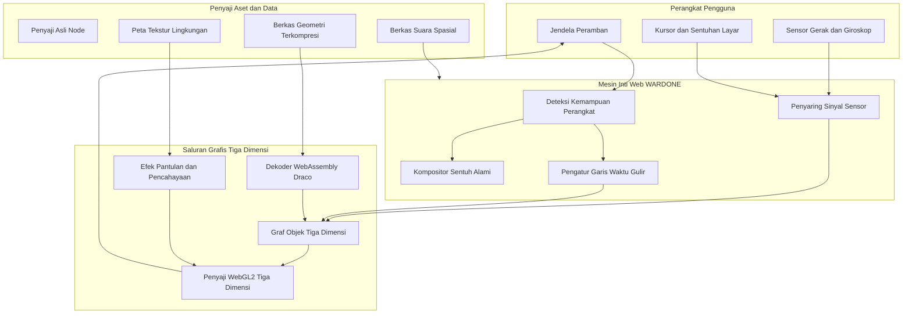
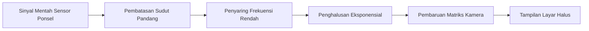
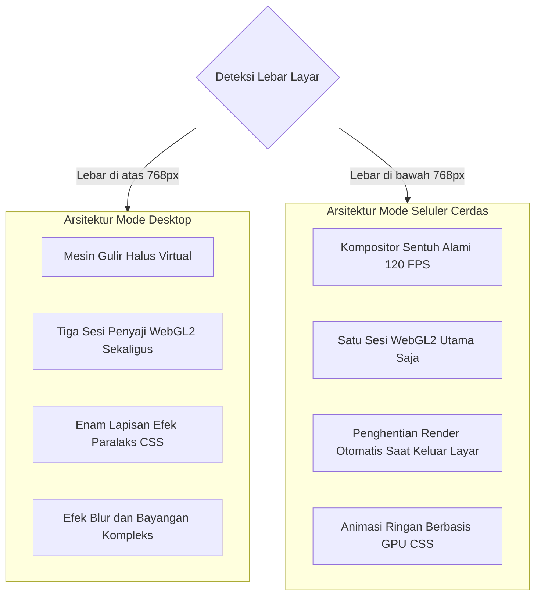
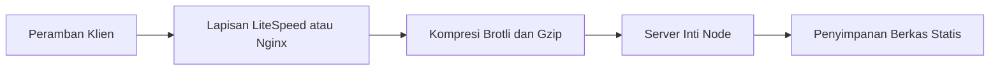

# WARDONE Interactive Web Platform

Dokumentasi arsitektur teknis, sistem grafis tiga dimensi, dan standar performa visual komunitas WARDONE.

Dibuat secara khusus untuk menghadirkan pengalaman web imersif yang memadukan rendering grafis modern, interaksi sensor perangkat fisik, dan tata letak responsif adaptif.

## Visi dan Konsep Utama

Platform web WARDONE dirancang sebagai representasi digital dari ruang komunitas WARDONE. Fokus utama pengembangan adalah menciptakan dunia visual yang hidup tanpa mengorbankan kecepatan akses dan kenyamanan navigasi pengguna, baik pada perangkat desktop berlayar lebar maupun perangkat ponsel pintar dengan keterbatasan komputasi grafis.

Sistem ini menggabungkan rendering objek 3D interaktif, efek kedalaman paralaks berlapis, tata suara spasial dinamis, serta sistem tata letak modern yang sepenuhnya dibangun dengan standar web murni tanpa ketergantungan pada pustaka pihak ketiga yang berlebihan.

## Arsitektur Sistem

Sistem web WARDONE dibangun dengan pemisahan peran yang tegas antara lapisan penyaji statis, mesin rendering grafis tiga dimensi, modul kontrol sensor fisik, dan pengelola alur interaksi antarmuka pengguna.

## Saluran Grafis Tiga Dimensi dan Kompresi Draco

Pengalaman visual utama ditenagai oleh mesin WebGL2 yang mampu merender karakter maskot WARDONE secara langsung di peramban dengan kualitas material tingkat tinggi.

### Kompresi Geometri dengan Draco

Berkas model tiga dimensi mentah berukuran lebih dari 31 megabita, ukuran yang terlalu masif untuk didistribusikan secara efisien melalui jaringan seluler. Untuk mengatasi hal ini, geometri model dikompresi menggunakan teknologi Google Draco.

* Kompresi Kuantisasi Posisi: Koordinat titik vertex dikuantisasi secara presisi sehingga mempertahankan bentuk kurva karakter secara sempurna.
* Pengurangan Ukuran: Ukuran berkas berhasil ditekan hingga 5.0 megabita, menghasilkan efisiensi unduhan lebih dari 83 persen.
* Dekompresi Asinkron: Modul WebAssembly Draco Decoder bekerja di latar belakang untuk menguraikan data geometri terkompresi langsung ke dalam memori grafis peramban sebelum proses render pertama dimulai.

### Sistem Pencahayaan dan Material

Karakter maskot menggunakan material berbasis fisik yang merespons kondisi cahaya lingkungan secara dinamis:

* Pencahayaan Hemisfer: Menghasilkan bayangan alami antara bagian atas yang terkena cahaya langit dan bagian bawah yang memantulkan warna tanah atau awan.
* Peta Lingkungan Dinamis: Menggunakan peta High Dynamic Range beresolusi terukur untuk memberikan efek kilau reflektif pada permukaan helm dan baju luar maskot.
* Pembatasan Beban Grafis: Pada perangkat dengan resolusi layar sangat tinggi, rasio piksel perangkat dibatasi secara pintar pada angka maksimal 1.5 untuk desktop dan 1.0 untuk perangkat seluler guna mencegah panas berlebih pada unit pemroses grafis.

## Mesin Sensor Gerak dan Giroskop Fisik

Pada perangkat seluler, interaksi kursor tradisional digantikan oleh sistem pelacakan orientasi fisik perangkat secara langsung.

### Algoritma Penghalusan Sensor

Sinyal orientasi sudut dari sensor perangkat sering kali memiliki derau acak frekuensi tinggi akibat getaran tangan pengguna. Mesin giroskop WARDONE menerapkan filter matematika khusus:

1. Normalisasi Sumbu: Mengambil parameter kemiringan horizontal dan vertikal, lalu memusatkannya pada posisi santai saat ponsel dipegang di depan pengguna.
2. Pembatasan Rentang Maksimum: Sudut rotasi dibatasi secara proporsional agar sudut pandang kamera tidak berputar melebihi batas pandang alami adegan.
3. Interpolasi Eksponensial: Setiap pembaruan posisi menggunakan faktor lerp bertahap, sehingga pergerakan kamera terasa anggun dan bebas dari patahan visual.

## Arsitektur Adaptif Seluler

Tantangan terbesar dalam merancang situs berbasis grafis tinggi adalah menjaga agar perangkat ponsel tetap bekerja dengan kecepatan 60 hingga 120 bingkai per detik tanpa mengalami panas atau jeda gulir layar.

Situs WARDONE menerapkan arsitektur ganda yang membedakan penanganan grafis antara mode desktop dan seluler:

### Keunggulan Arsitektur Seluler WARDONE

* Akses Sentuh Alami: Menghilangkan pembungkus gulir virtual pada ponsel sehingga peramban dapat memanfaatkan thread kompositor perangkat keras secara penuh. Hasilnya adalah respons sentuh instan dengan nol milidetik latensi.
* Penghematan Memori Grafis: Penyaji WebGL2 untuk bagian tengah dan bawah dinonaktifkan pada perangkat ponsel, digantikan oleh aset visual berkecepatan tinggi yang dianimasikan menggunakan akselerasi perangkat keras CSS.
* Penghentian Render di Luar Bidang Pandang: Begitu pengguna menggulir melewati area sambutan utama, siklus animasi maskot tiga dimensi langsung ditidurkan. Hal ini menghemat konsumsi baterai dan membebaskan siklus kerja prosesor.
* Penghapusan Filter Berat: Filter blur dinamis dan bayangan kompleks yang membebani kinerja kartu grafis ponsel dihilangkan secara selektif pada tampilan seluler untuk menjamin stabilitas rendering visual.

## Tata Suara Spasial Interaktif

Platform ini dilengkapi sistem audio interaktif berbasis Web Audio API yang dirancang untuk memberikan kedalaman atmosfer tanpa mengganggu kenyamanan pengguna.

* Atmosfer Lingkungan: Trek suara latar berulang yang dirancang secara halus untuk menemani eksplorasi pengguna di dalam dunia langit WARDONE.
* Efek Respon Antarmuka: Suara frekuensi terarah saat pengguna berinteraksi dengan tombol aksi atau elemen interaktif tertentu.
* Kepatuhan Kebijakan Peramban: Sistem secara tertib mematuhi aturan peramban modern mengenai pelarangan pemutaran suara otomatis, di mana saluran audio hanya akan aktif setelah adanya tindakan fisik nyata pertama dari pengguna.

## Tipografi Adaptif dan Desain Responsif

Semua komponen tata letak, ukuran teks, dan jarak spasi antar elemen dikalkulasi secara matematis menggunakan fungsi kalkulasi skala peramban murni.

* Penggunaan Skala Matematis: Nilai ukuran font menggunakan kombinasi persentase lebar layar dan nilai piksel batas untuk memastikan keterbacaan yang sempurna di semua ukuran layar, mulai dari ponsel berlayar 360 piksel hingga monitor resolusi ultra tinggi.
* Variabel Desain Terpusat: Semua palet warna, mulai dari biru langit khas WARDONE hingga gradasi malam, didefinisikan dalam variabel terpusat yang memudahkan penyesuaian tema secara konsisten.

## Infrastruktur dan Penyiapan Lingkungan

Server web produksi dirancang seringkas mungkin sesuai prinsip minimalisme performa tinggi:

### Menjalankan Server Lokal

Proyek ini tidak memerlukan kompilasi rumit dan dapat langsung dijalankan menggunakan instalasi standar Node.

1. Buka terminal pada direktori proyek.
2. Jalankan perintah eksekusi server:
   node server.js
3. Buka alamat lokal di peramban:
   http://localhost:3333

## Lisensi dan Hak Cipta

Perangkat lunak ini dirilis di bawah lisensi terbuka MIT License.

Hak cipta dilindungi oleh Yerikho Arfensias Effendi dan Komunitas WARDONE. Anda bebas menggunakan, memodifikasi, dan mendistribusikan kode ini untuk keperluan komunitas dan pengembangan teknologi visual.
